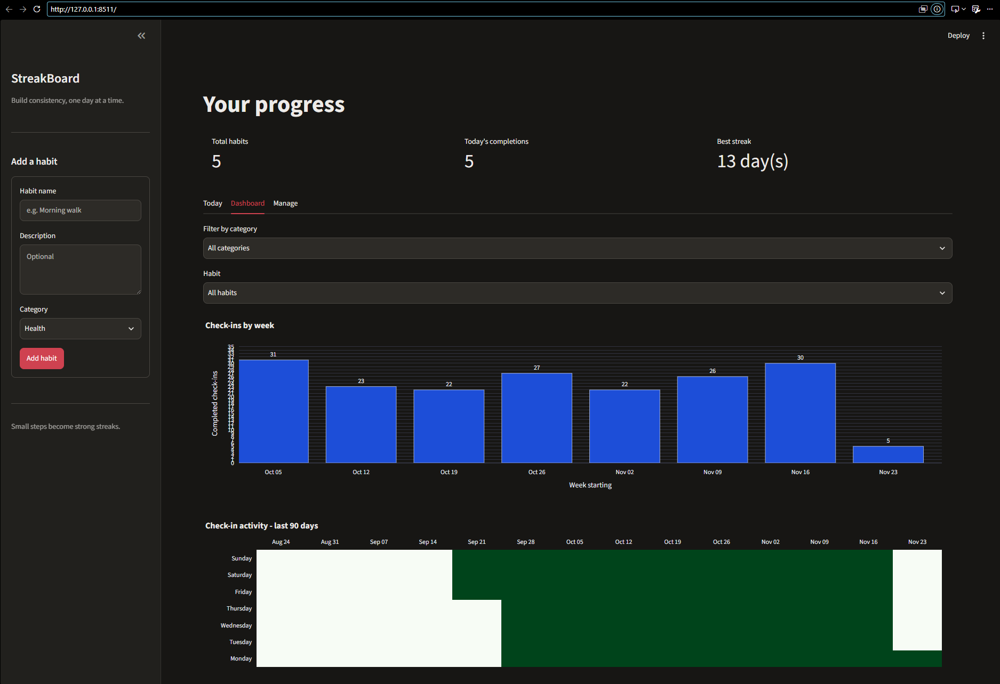
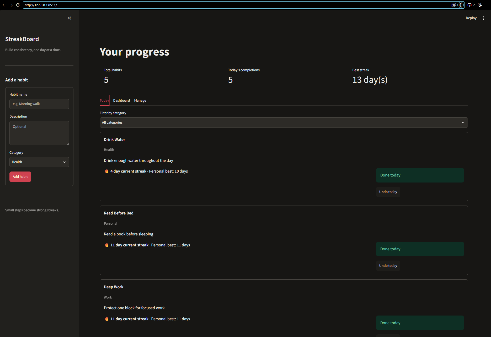
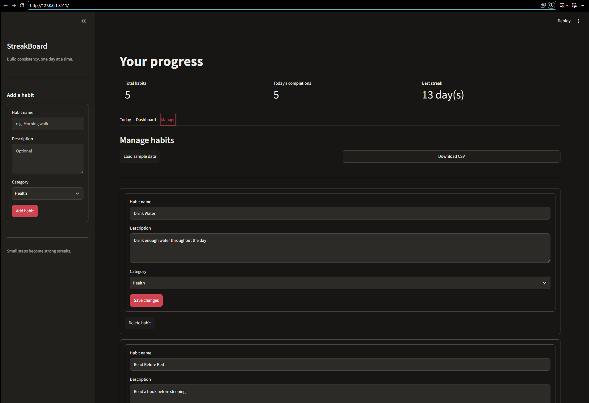

# StreakBoard

## Project Name

**StreakBoard**

## Description

StreakBoard is a habit-tracking web application built with Python and Streamlit.
It lets users create habits, check them off daily, review streak statistics,
explore progress charts, organize habits by category, and export check-in data.
SQLite provides persistent local storage, while Plotly visualizes completion
patterns and progress.

## Purpose

The purpose of StreakBoard is to make habit consistency easy to understand and
encourage regular progress. It is designed for people who want a simple,
privacy-friendly way to track daily habits and review streaks, activity,
completion rates, and categories.

## Features

- Add habits with a name, optional description, and category
- Mark habits complete for today and undo today's check-in
- View current and longest streaks for every habit
- Filter habits and dashboard charts by category
- Review weekly completion totals for the last eight weeks
- View a 90-day calendar-style check-in heatmap
- Compare 90-day completion rates across habits
- Review the breakdown of habits by category
- Edit habit names, descriptions, and categories
- Delete habits with a confirmation step
- Load five realistic sample habits with randomized 60-day check-ins
- Export every check-in as a CSV file
- Display friendly empty states and summary metric cards
- Preserve data across restarts with SQLite
- Preserve native Streamlit light and dark theme behavior

## Technologies

- **Python** - application and data logic
- **Streamlit** - interactive web interface
- **SQLite** - persistent local database
- **Plotly** - charts and dashboard visualizations
- **pytest** - automated unit and database tests
- **python-dotenv** - environment configuration
- **Python venv** - isolated project dependencies

## AI Tools Used

- GitHub Copilot / Copilot SDK - code generation, refactoring, debugging, tests,
  documentation, and implementation planning
- Pylance Python coding assistance - Python diagnostics and coding context
- pytest - AI-supported test-driven verification

## Installation

StreakBoard requires Python 3.10 or newer.

### 1. Clone or download the project

```powershell
cd "path\to\StreakBoard"
```

### 2. Create a virtual environment

```powershell
python -m venv venv
```

### 3. Activate the virtual environment

```powershell
.\venv\Scripts\Activate.ps1
```

If PowerShell blocks the activation script, enable local scripts for the current
PowerShell session:

```powershell
Set-ExecutionPolicy -Scope Process -ExecutionPolicy Bypass
.\venv\Scripts\Activate.ps1
```

### 4. Install dependencies

```powershell
python -m pip install --upgrade pip
python -m pip install -r requirements.txt
```

### 5. Configure the environment

Copy `.env.example` to `.env` if a custom database location is needed:

```powershell
Copy-Item .env.example .env
```

The default database location is `data/streakboard.db`.

## Running the Application

With the virtual environment activated, run:

```powershell
streamlit run app.py
```

Then open the local URL printed by Streamlit, normally:

```text
http://localhost:8501
```

The database and `data/` directory are created automatically if they do not
already exist.

### Run Tests

```powershell
python -m pytest -q
```

## Project Structure

- `app.py` - thin Streamlit entry point
- `src/streakboard/app.py` - Streamlit interface and interaction flow
- `src/streakboard/db.py` - SQLite schema, migrations, and data access
- `src/streakboard/stats.py` - streak calculations
- `src/streakboard/charts.py` - Plotly chart construction
- `tests/` - pytest unit and database tests
- `data/` - local SQLite database storage
- `PROMPT.md` - running record of prompts and implementation work
- `.env.example` - example environment settings
- `requirements.txt` - Python dependencies

## How AI Was Used

AI coding assistance was used to generate implementation drafts, organize the
codebase, add tests and migrations, review edge cases, refactor code, and
improve documentation. Final behavior was checked through compilation,
automated tests, database validation, and local Streamlit health checks.

### Example Prompt 1: Build the First Working App

> "Build the first working version of StreakBoard. Users can add a habit (name, optional description), see a list of habits, and mark each as done for today. Store data in SQLite. Put database code in db.py and the UI in app.py. Tables: habits and check_ins (habit_id, date). make sure to create a virtual python environement using venv and use that, not global. Update PROMPT.md."

This prompt established the project foundation: the SQLite data model, the
first working user flow, the virtual environment requirement, and the initial
modular entry points.

### Example Prompt 2: Add the Dashboard and Visualizations

> "Create charts.py with Plotly chart functions and add a \"Dashboard\" tab in app.py with: (1) a weekly completion bar chart for the last 8 weeks, (2) a calendar-style heatmap of check-ins for the last 90 days, and (3) a completion rate per habit chart. Add a habit selector to filter the charts. Update PROMPT.md."

This prompt shifted StreakBoard from a basic habit checklist into a visual
progress dashboard and separated chart construction from Streamlit rendering.

### Example Prompt 3: Improve Edge-Case Reliability

> "Review the whole codebase for bugs and edge cases: duplicate check-ins on the same day, app state after deleting a habit, empty database, very long habit names, date handling around midnight, and Streamlit rerun issues. List the problems you find first, then fix them one by one. Update PROMPT.md with each bug and fix."

This prompt improved reliability across database mutations, UI state, date
boundaries, text limits, duplicate check-ins, and reruns. It also established
the pattern of listing problems before implementing fixes.

The complete list of prompts, summaries, changes, and problems is available in
[PROMPT.md](PROMPT.md).

## Screenshots

Replace these placeholders with screenshots of the completed application:

### Dashboard



### Today View



### Manage View



## Future Improvements

1. Add user accounts and optional cloud synchronization.
2. Add reminders and browser notifications for habits due on a selected schedule.
3. Support custom recurrence patterns, such as weekdays, weekly targets, or flexible goals.
4. Add editable historical check-ins and calendar-based retroactive completion.
5. Add exportable reports, progress goals, and downloadable chart images.
6. Add more comprehensive UI testing with Streamlit AppTest or browser automation.

## Vibe Coding Reflection

Complete this template from your own experience:

1. **What did I want to build, and how closely did I achieve it?**
   [Describe the original goal and how closely the finished app matches it.]

2. **Which prompts or iteration patterns worked best?**
   [Describe the prompts that produced the most useful and complete results.]

3. **When did the AI make mistakes or produce unsuitable results?**
   [Describe a bug, wrong assumption, or implementation that needed correction.]

4. **What did I learn about prompting and reviewing AI-generated code?**
   [Describe which instructions, constraints, and verification steps worked best.]

5. **What would I do differently on the next vibe coding project?**
   [Describe process, planning, testing, or documentation changes.]

6. **What am I most proud of in this project?**
   [Describe the feature, workflow, quality, or learning outcome you value most.]
